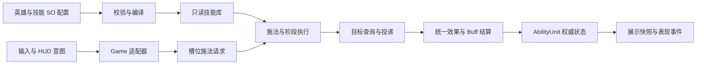

# 组合技能与 Buff 基础架构

更新日期：2026-09-24。状态：**组合技能/Buff核心已实现并接入Game。** 实现范围和验证证据见本文末尾；未来Excel、完整选人界面和完整时停仍未实现。

## 需求来源与这次调整

用户最新要求：游戏是可选择不同英雄、面对海量敌人的肉鸽；技能系统是核心地基，应由目标、范围、多段和多个效果组合，而不是为每个具体技能写完整专用逻辑。可以暂缓具体技能功能，优先建立可维护、可扩展、便于未来 Excel 配表的底层，并更新项目开发文档。

用户用“全体、零伤害、时停”解释特殊效果的可组合性。这是架构例子，不等于要求本轮完成全部时停行为。单体/范围、几段也属于解释方向，具体分类由团队按职责拆分，不能把用户举例机械地变成互相重叠的枚举。

此前确认仍适用：Q 自身蓄层，满层施放后仅增加攻速；W/R 施加减速；E 已改为目标点范围伤害；R 可命中所有怪物类型，命中第一只后爆炸。Game 暂停迷雾、昼夜、显隐等视野机制，不将旧的真实迷雾接入要求重新恢复。

### 已发现的断层

旧 [架构调研](skill-architecture-proposal.md) 已提出 Cast、Targeting、Area、Delivery、Effect、Buff 分工，并在独立 Abilities 模块建立效果数组、共享 Blob、每拥有者独立槽位和 Buff 生命周期。但是 Game 后续使用固定 `CombatAbilityId.Q/W/E/R`、QWER 专用参数/状态和施法分支，没有复用这套边界。将参数移入四份 ScriptableObject 只解决了数值编辑问题，没有完成组合架构。

独立 Abilities 也有首版限制：`InstantCircle / PersistentCircle / SelfCircle` 混合投递方式、目标和几何；Buff 的来源合并及属性字段仍较固定。不能把独立演示会话直接作为通用 Game 核心。

这次主 AI 裁决：**沿用原 Abilities 核心名称和现有资源 GUID，提取无 UI 的 Core 程序集，Game 和独立演示通过各自适配层接入；不再另建第三套技能规则。** 移动/替换已有脚本和资源时必须保留或显式迁移序列化引用。

## 调研依据与采用范围

主 AI 本轮实际读取了以下一手资料。借鉴其职责、生命周期和数据所有权，不移植 Unreal 的对象模型、联网预测或整套框架。

| 来源 | 采用的思想 | 本项目限制 |
| --- | --- | --- |
| [Epic Gameplay Ability System](https://dev.epicgames.com/documentation/en-us/unreal-engine/gameplay-ability-system-for-unreal-engine) | 技能执行、属性和效果分离 | 本项目使用 Unity ECS，不建立逐敌人的 UObject 风格能力对象。 |
| [Epic Gameplay Effects](https://dev.epicgames.com/documentation/en-us/unreal-engine/gameplay-effects-for-the-gameplay-ability-system-in-unreal-engine) | 即时变化与持续状态分离，持续状态有独立生命周期 | 只实现当前需要的伤害、治疗、Buff、驱散及属性/控制基础，不宣称完整 GAS 功能。 |
| [Unity Entities 1.4 Blob assets](https://docs.unity3d.com/Packages/com.unity.entities@1.4/manual/blob-assets-concept.html) | 共享定义使用不可变、非托管数据，供运行系统读取 | Blob 不保存冷却、层数、生命或局内等级；性能目标仍须实测。 |

本轮也尝试访问 Valve 的 AbilityDataDriven 资料，但页面加载受阻；不得将其具体正文写为本轮已核实的依据。历史调研及历史性能结果仅说明当时版本，不替代本次重构验收。

## 模块边界与数据权威

- **Core**：定义合同、编译数据、目标几何、技能阶段、统一效果/Buff 规则；不引用输入、相机、HUD、演示控制器或 UI 框架。
- **Game 适配器**：场景装配、玩家意图、敌人/普攻接入、展示快照和会话生命周期；不重新实现技能伤害和 Buff 算法。
- **表现层**：按槽位对应技能定义绘制指示器、显示冷却和播放反馈。指示器与命中共用范围参数，视图不决定实际命中。
- **编辑器工具**：创建/迁移资源、校验并报告具体资源/字段错误；不在打开场景或进入 Play 时覆盖开发者配置。

Game 的生命、属性和持续状态以 `AbilityUnit` 等 Core 运行态为权威。`CombatPlayer` 可保留 UI/统计用的镜像快照，但不可成为第二份可独立写入的生命权威；普攻、技能、Buff 周期伤害走同一结算入口。同步快照不能反向覆盖权威数据。

共享 SO/Blob 在会话内只读；拥有者持有独立技能等级、冷却、充能与状态。会话负责创建/销毁编译库和运行容器，释放前结束引用它们的作业。场景、UI 回调和动态对象分别明确归属，重开不遗留上局阶段、弹体或 Buff。

## 正交配置合同

以下维度已由 SkillDefinition / SkillStage / EffectDefinition / BuffDefinition 实现。当前枚举见下方实际支持表；未来扩展不自动视为已实现。非法枚举与引用在编译阶段拒绝。

| 维度 | 配置语义 | 不承担的职责 |
| --- | --- | --- |
| 输入目标 | 自身、单位、目标点、方向 | 不决定伤害类型。 |
| 目标集合 | 单体、区域、全体；阵营和存活过滤 | 全体不是无限半径圆，也不是关闭过滤。 |
| 区域几何 | 圆形、扇形、直线；半径/角度/长度/宽度 | 不控制 Buff 时长。 |
| 投递 | 立即、落点弹体、直线弹体等当前支持方式 | 不另写一套伤害公式。 |
| 阶段 | `Stage[]`，每段的延迟、重复次数、重复间隔、目标、形状、投递及效果列表 | 不以 Q/W/E/R 作为分支身份。 |
| 效果 | Damage、Heal、ApplyBuff、Dispel 及显式扩展模块 | 不与输入槽绑定。 |
| Buff | 生命周期、周期、层数、属性修饰、控制状态及来源策略 | 不保存于共享 SO 的可变字段。 |
| 表现 | 指示器、图标及施放/命中反馈引用 | 不决定目标是否命中。 |

“几段”使用整数重复次数和有序阶段，而不是为一段/两段/三段增加枚举。一个技能可有多段，每段可组合多个效果。单段查询默认目标去重，不同段可以重复命中；影响这一规则的投递类型需明确写入配置合同。

取消瞄准不消耗资源。确认时重新检查死亡、距离、冷却、充能及施法条件；成功提交只支付一次。延迟执行携带来源与施法归属，执行时检查目标实体有效性，不能读取已经销毁的 Entity。单体阶段必须由Unit瞄准或直线首碰提供目标，否则编译拒绝。当前Game单位瞄准从鼠标附近选择敌人；友方单位点选UI暂未提供。阶段按到期时间排序，同时间按提交/阶段顺序；重复次数有限，到期则补发。中心/方向在提交时快照，各次查询当前存活目标。Game模拟每帧dt封顶0.1秒，因此严重卡顿时模拟时间变慢；不是墙钟追赶。直线弹按扫掠最早接触点首中，友方直线弹排除施法者。

## 效果父类与特殊模块

编辑期采用效果配置共性父类；首批具体配置为 Damage、Heal、ApplyBuff、Dispel。父类负责共同的配置/校验/编译边界，不能成为同时管理输入、弹体、UI、Buff 和所有英雄特例的万能技能类。

扩展流程：

1. 新模块定义自己的类型化配置与合法参数，继承效果配置基础合同。
2. 在配置编译阶段校验引用和支持能力，将配置转换成非托管参数和明确 opcode/执行器标识。
3. 执行层将对应请求交给该模块；模块通过统一属性/Buff/效果接口产生结果，不能偷偷建立另一份生命或伤害系统。
4. 完善失败行为、生命周期、来源归属、验证条件和文档；注册遗漏或未支持 opcode 必须报错，不能静默忽略。

编译期间可以使用托管多态；万级战斗热路径不对每个目标调用反射、字符串字典或创建独立托管效果对象。新增机制仍可能需要新增代码；可组合不等于任意未来技能都能只填表。

### 时停例子的边界

可表达为“全体敌人目标集合 + 应用 TimeStop 控制 Buff”，无需放一个无意义的零伤害节点。本轮先建立控制标记和扩展基础，**不宣称实现冻结整个世界**。

真正实施时停前必须规定移动、攻击、技能阶段、弹体、Buff 周期及解除计时分别是否暂停，施法者是否豁免。不能用全局 `Time.timeScale = 0` 冒充技能时停；否则解除计时及正常 UI 也可能被暂停。

## Buff 与属性合同

定义与实例分离。定义提供持续时间、叠层/刷新/周期策略、修饰条目和控制贡献；实例持有定义索引、来源实体、来源技能、层数、强度、结束时间与下一次周期时间。

当前实现以下生命周期；未提供的策略不出现在可用配置中：

- 来源键为 ByDefinition、BySource（定义+来源实体+来源技能）、Independent；叠层为 Refresh 或 AddAndRefresh（上限1–20）。当前重复应用固定刷新共用时长、固定保留周期，不支持每层独立到期或自选刷新策略。
- 推荐周期刷新默认保留下一跳时间，避免连续施加让周期效果一直无法触发。到期边界的一跳与移除顺序必须稳定。
- 属性条目使用属性 ID、运算方式和数值；基础属性与最终属性分开，由有效贡献重算，禁止到期时做反向加减恢复。
- 多个来源的控制状态按有效贡献聚合；其中一个控制 Buff 到期时，不得清除其他仍有效来源。
- 来源销毁、目标死亡、驱散、卸下常驻能力和重开分别有清理规则。来源 Entity 含版本信息；长期归属不依赖失效实体上的组件。
- 当前普攻命中显式调用 RecordBasicAttackHit，只有此入口积累命中条件；技能伤害和周期伤害不调用它。尚无任意事件链/被动触发框架。

每层独立到期、完整强弱驱散、抗性/免疫、复杂乘区、反伤链、光环驻留和完整 Dota 攻击修饰器不是本轮必交能力。若没有相应运行支持，编译器应拒绝配置，而不是把其字段保留为无效按钮。

## 英雄装配与输入槽

当前 HeroDefinition 提供稳定 ID、名称、基础属性和 SkillDefinition[] 装配；数组顺序决定输入槽，初始等级固定1。英雄表现仍为场景引用，局内升级尚未接入。Q/W/E/R 表示输入槽，不表示技能本身。

同一技能应能放入不同英雄、不同槽位；不能修改模拟系统来适配。切换英雄创建该英雄的独立运行态；共享定义不被等级、冷却、充能和肉鸽升级修改。英雄定义接入与完整选人界面属于不同交付项，不能仅有配置便声称已交付选人流程。

## 未来 Excel 配表合同

用户将提供技能 Excel。当前先确定稳定数据合同；**本文件不代表 Excel 导入器、模板或正式表格已经制作完成**。

建议表结构：

| 表 | 主键与引用 | 内容 |
| --- | --- | --- |
| Hero | `heroId` | 基础属性、展示资源 ID。 |
| HeroLoadout | `heroId + slot` → `abilityId` | 英雄装配和初始等级。 |
| Ability | `abilityId` | 名称、施法条件、消耗、冷却、输入目标和表现。 |
| Stage | `abilityId + stageId` | 显式顺序、延迟、重复、范围、投递。 |
| StageEffect | `abilityId + stageId + effectOrder` | 效果类型、参数及 Buff/模块引用。 |
| Buff | `buffId` | 来源合并、持续、叠层、刷新、周期和控制基础。 |
| BuffModifier | `buffId + modifierOrder` | 属性、运算和数值。 |

所有导入数据带 `schemaVersion`。稳定 ID 使用非本地化字符串，例如 `hero.frost_archer`、`ability.volley`、`buff.frost_slow`；显示名可以变化，稳定 ID 不随中文名称变化。Excel 行号、Unity 文件名、数组索引和当前输入槽都不能充当稳定身份。

多段/多效果使用独立行和显式顺序，避免逗号拼接或单元格 JSON。枚举使用稳定机器值，中文说明另列；时间统一秒、距离统一米、百分比使用约定的小数倍率，列名或说明必须带单位。

导入后先检查重复 ID、悬空引用、未知枚举/模块、NaN/Infinity、非法负值、不合法顺序和未支持组合，再编译成运行索引。报错必须定位表、行、列及资源；失败时不能部分覆盖现有资源。按稳定 ID 更新既有资源并保留 GUID，避免重导破坏场景引用。

## 本轮迁移范围与行为差异

以下为主 AI 的实施裁决，**不是用户逐项确认的新玩法**。用户已允许以基础架构优先，具体技能差异必须在交付中公开。

| 项目 | 本轮目标 | 保留/变化 |
| --- | --- | --- |
| Q | 命中蓄层条件 + 自身攻速 Buff | 保留满层后施放、仅增加攻速；状态属于拥有者，不写入技能资源。 |
| W | 扇形目标查询 + 伤害 + 减速 Buff | 暂作为组合示例；**不保留旧版九条射线各自首命中规则**。因此扇形内命中集合与旧版不同。 |
| E | 目标点弹体 + 落点范围伤害 | 保留已确认的范围伤害方向，不恢复视野效果。 |
| R | 直线弹体首中 + 爆炸阶段 + 伤害/减速及相应控制 | 保留所有怪物类型可被首次命中；具体阶段与伤害叠加语义须以迁移配置明确展示。 |
| 英雄 | loadout 指向通用技能定义 | 本轮不以新增多名完整英雄内容为前提；完整选人 UI 按实际交付单列。 |
| 旧 Abilities 演示 | 消费提纯后的共享核心 | 演示场景不成为 Game 的依赖；保留其历史证据，重新验证改动部分。 |
| 视野 | 继续关闭 Game 视野接入 | 独立历史资料和封存代码不代表 Game 当前启用。 |
| 时停 | 控制标记/特殊模块扩展合同 | 不承诺冻结技能、弹体、Buff 及整个世界。 |

本轮最低完整地基应包括：组合定义能够编译并实际执行、Game 接入统一结算、英雄装配驱动槽位、指示器消费同一配置、Buff 贡献可正确撤销，以及非法配置能被明确拒绝。仅增加类、枚举和文档但仍由旧 QWER 分支执行，不满足本轮目标。

## 实际交付与支持值

2026-09-24 技能编辑工作台：新增 `Assets/Scenes/技能配置工作台.unity`，通过正式 `SkillDefinition` 和 `SkillCatalog` 创建/编辑/校验技能。共享 `SkillAimPreview`、`SkillPreviewGeometry` 同时服务 Editor 与 Game；正式 `indicatorColor` 已进入编译快照，替代 Game 原场景颜色字段。Game 仍预览首段，编辑器可选择或叠加各段；距离按 Unity 世界单位，范围几何不依赖父节点缩放。生命周期、保存规则和本轮验证见 [技能配置工作台](skill-authoring-workbench.md)，旧版“颜色仅供独立示例”的说明已被本次实现取代。

2026-09-24 Project 资源命名补充：`Assets/Game/Skills/Foundation` 下的 4 份 Buff、8 份效果、4 份技能、技能库与 2 份英雄装配共 19 份 `.asset` 已改为中文文件名；例如 `Buffs/冰霜专注.asset`、`Effects/施加扇击减速.asset`、`Skills/冰晶巨箭.asset`、`游戏技能库.asset`。`AbilityFoundationAssets` 的生成路径及现有资源迁移入口同步更新，旧英文路径再次运行时迁移至中文路径，不创建重复资源。原 `.meta` GUID、技能稳定 ID、序列化字段与场景引用保留。改动前副本为 `Backups/foundation-chinese-names-20260924`。隔离 Unity 6000.3.18f1 编译并运行 `AbilityFoundationAssets.LocalizeExisting`，日志 `D:/UnityProject/myGame_validation_20260923/foundation-localize-20260924.log` 记录移动 19 份；重复运行日志 `foundation-localize-repeat-20260924.log` 记录移动 0 份。主项目静态核对 19 个 GUID、资源内容与 `Game.unity` 对英雄和技能库的引用。此项未重新运行 Player 或游戏功能检查。

2026-09-24 编辑器易用性补充：技能、Buff、效果、英雄、技能库与旧被动资源使用 Editor 程序集的中文 Inspector；组合阶段及属性修饰项提供中文字段、枚举与单位提示。正式技能的旧示例字段在 Inspector 隐藏，旧示例配置继续可编辑。序列化键、稳定 ID 与既有 GUID 未修改。Unity 官方的 `InspectorName` 仅用于枚举成员，普通字段由自定义 Editor/PropertyDrawer 绘制。此项需要单独核对 Unity 编译与实际 Inspector 展示，不能沿用前次 Player 检查作为验证。

本次已在隔离 Unity 6000.3.18f1 Editor 运行 `AbilityInspectorValidation.Validate`：九类资源匹配中文 Inspector，`AimMode` 的 `enumDisplayNames` 包含“目标点”，阶段及属性修饰的 PropertyDrawer 已注册，脚本编译通过；日志为 `Logs/AbilityFoundation/chinese-inspector.log`。这验证了编辑器注册与文案数据，未做主项目 Editor 窗口的人工目视截图。改动仅涉及资源 Inspector、创建菜单、枚举显示名和开发规则；未重新运行 Player。新资源入口为 Project 右键 `Create > Roguelike > 技能`。依据：[Unity InspectorName 文档](https://docs.unity3d.com/cn/6000.0/ScriptReference/InspectorNameAttribute.html)、[Unity PropertyDrawer 文档](https://docs.unity3d.com/jp/current/ScriptReference/PropertyDrawer.OnGUI.html)。

| 项目 | 当前实现 |
|---|---|
| Core程序集 | `Assets/Game/Abilities/Core/Roguelike.Abilities.Core.asmdef`；只依赖Entities/Transforms/Math/Collections/Burst，未安装第三方GAS |
| 输入目标 | `AimMode`: Self / Point / Direction / Unit |
| 目标范围 | `TargetScope`: Self / Single / Area / All；`TargetRelation`: Enemies / Allies |
| 形状/投递 | `AreaShape`: Circle / Cone / Line；`DeliveryKind`: Instant / PointProjectile / LinearProjectile |
| 效果模块 | `EffectDefinition`抽象SO及Damage/Heal/ApplyBuff/Dispel；可选择Selected或Source，Source每段只执行一次；效果依配置顺序执行 |
| Buff属性 | MoveSpeed / AttackDamage / AttackSpeed；`(base+Add)*(1+Percent)*Multiply`，结果不小于0；Multiply的贡献为`value^(强度*层数)` |
| 控制 | MovementBlocked / AttackBlocked / CastBlocked；OR聚合，分别约束移动、普攻和新施法提交。不会自动暂停弹体、Buff时钟或中断已提交阶段 |
| 多段 | 最多32段，每段1–32次；延迟/重复间隔以秒计；全体查询仍实际遍历目标 |
| 状态 | AbilitySlot保存槽位独立冷却/充能/命中层数；ActiveBuff保存来源/层数/到期/周期；AbilityUnit保存唯一生命/聚合属性 |
| 会话 | GameCombatSession拥有Blob与CombatOwned实体，重开先Complete再销毁；AbilityExecution系统对象拥有Native网格与候选列表并在系统销毁时释放 |
| 资源 | `Assets/Game/Skills/Foundation`：技能库、2份英雄装配、4技能、4Buff、8效果模块；2个英雄共用技能定义 |
| 迁移 | 删除四个CombatQ/W/E/RSkillConfig及旧资源；Game场景改绑hero/catalog，保留原3000敌人/30米安全区与布局；脚本迁移保留GUID |

范围查询使用8米XZ网格，局部精确几何后执行效果；All遍历本World当前单位。Game强制单会话，旧示例与Game双向拒绝同时运行。网格构建、候选收集/排序与效果写入当前为串行宿主执行；Buff Tick和敌人移动/攻击使用Burst并行Job，然后在明确同步点交接。没有宣称所有技能热路径均并行，也没有把架构选择当作万敌达标证据。

技能库和英雄资源在重开时编译；指示器按编译首段构建展示快照，HUD名称也在会话创建时快照。修改SO后重开才生效。取消瞄准不支付资源，提交通过才支付；同帧施法者死亡取消后续阶段/飞行。

旧独立示例的扁平字段只用于兼容，stages为空仍由旧调度运行；Game明确拒绝这种资源。现阶段保留其兼容字段和独立场景，未要求将历史示例全部重写。Game技能等级固定1，旧levelPower只服务旧示例；被动技能通用化、局内升级、完整选人UI、Excel导入器和具体特殊机制未交付。指示器仅显示首段，命中特效仍简化。

## 团队取舍和审查

架构代理提纯配置/编译/Buff；设计代理负责合同、迁移工具与规则校验；主AI负责Game适配、执行器、指示器快照、程序集边界、冲突裁决与串行Unity验证。实际发现并修复：碰撞使用爆炸半径、首碰按圆心排序、友方弹体碰自己、施法者中途死亡仍执行、敌人不消费攻击Buff、旧示例只有单向隔离、指示器直接读资源导致预览/快照不一致。

未来开发遵循项目AGENTS.md及版本化skill的新“技能/Buff架构底线”。新机制可通过EffectDefinition编译现有opcode；需要新运行行为时须增加类型化数据及独立执行逻辑，再接共享效果边界。未知EffectKind编译失败；不承诺拖一个任意脚本就能被Burst安全执行。

## 验证与证据

本次使用隔离副本 `D:/UnityProject/myGame_validation_20260923`，Unity 6000.3.18f1。主项目原Editor未被关闭或单独运行。重构前可恢复备份 `Backups/ability-foundation-20260924`。此前版本的build4/player3不作为本轮证据。

- `foundation-migrate3.log`：正式迁移成功，资源引用与Game场景已保存。
- `Logs/AbilityFoundation/foundation-build5.log`：最终Unity编译、41项组合规则检查及Windows构建通过；新增检查覆盖最早接触点与非法单体配置。
- `Logs/AbilityFoundation/foundation-legacy.log`：共享核心变动后的23项旧独立技能规则回归通过。
- `Logs/AbilityFoundation/foundation-player-final-ui.log` + `result.json`：最终3000敌人Player检查通过，包括真实HUD按钮、移动阻挡、普攻、组合技能、换英雄槽位、死亡重开。
- `Logs/AbilityFoundation/point-indicator.png`、`foundation-game.png`：最终URP离屏渲染含真实场景/UI，主AI已查看；指示器双圈可见，界面已移除固定英雄/固定Q施法说明，名称和状态两行可见。首次黑屏采样已替换，不作为通过证据。
- 最终Core/Game源文件哈希与验证副本一致，Core GUID无重复；场景hero/catalog引用和生成资产已同步主项目。

本轮没有完整万敌战斗性能实测；没有人工鼠标/键盘交互验收。Excel实际导入待用户提供表格；已约定ID、单位、拆表和失败原子性合同，不声称已有导入器。

