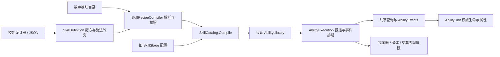

> 历史记录：当前规则请从 [开发文档总览](../README.md) 查阅。本页中的旧操作和旧验证结果不代表当前版本。

# 自由组合技能 V2：实施记录与使用说明

更新日期：2026-09-28。设计来源：[已批准的 V2 方案](skill-composition-v2-proposal.md)。

本轮交付模块目录、纯数据配方、共享编译、有限事件步骤、运行版本管理，以及中文步骤编辑和 JSON 文件。它覆盖提案的 A/B 基础与部分 D 编辑能力，**不代表提案中所有未来模块已实现**。

主 AI 已完成隔离 Unity 编译、纯数据合同和编辑事务检查，并打开实际中文窗口留证。正式工作区已迁移 5 个技能、登记 11 个效果及 9 个 Buff；其中通用治疗、通用驱散是复用已有执行器的新资源。没有游戏测试、QA 代理或万敌性能结论。

## 1. 用户授权与本轮决策

### 用户已授权

- 按已批准方案实施可自由组合技能，先做好模块功能，未来允许玩家拼装。
- 以数字 ID 配置和查表；技能、英雄、怪物分别从 1000、2000、3000 开始。
- 沿用 3D 游戏、Unity 单位范围、中文编辑器、配置保存与技能前后摇要求。
- 不恢复已经关闭的 Game 视野机制。

### AI 决定及理由

- 首版采用**有序、有限的事件树**。一个步骤组合“投递模块 + 查询模块 + 有序效果使用列表”，多个步骤通过父节点与事件端口连接，便于卡片编辑和明确校验。
- 同效果在不同位置使用时，节点及使用参数独立；不复制整套伤害结算器，不用具体技能 ID 或输入槽决定执行逻辑。
- 先开放伤害/治疗的受限数值覆盖。Buff 强度和时长覆盖暂不开放：现有合并键尚未支持独立规格，直接开放会让不同强度互相覆盖。
- `OnDamage` 表示实际生命损失大于零。它不同于提案中较宽泛的“伤害结算完成”；零伤害仍能施加固定 Buff，但不会触发该后续事件。
- 普通玩家只有一个释放根、较低节点/重复/派生上限；开发者也有硬上限。数值是首版安全边界，不是自动平衡结果或性能测量。
- 配方版先通过卡片改参数，Scene 范围拖动关闭，避免把修改写进保留的旧阶段。场景锚点及预览仍可使用。

## 2. 模块分工与实际调用链

| 文件或模块 | 职责 | 不负责什么 |
| --- | --- | --- |
| `Core/Recipes/SkillRecipe.cs` | 可保存的配方、步骤、效果使用、施法外壳 DTO | 不保存 Entity、运行冷却或 Unity 对象引用 |
| `SkillModuleCatalog.cs` | 数字模块注册、版本、玩家权限和覆盖范围 | 不通过 ID 数值猜测执行功能 |
| `SkillRecipeCompiler.cs` | ID 解析、端口和树结构校验，产生统一阶段输入 | 不为每次命中解析 JSON 或遍历模块目录 |
| `Core/SkillCatalog.cs` | 新旧输入共同的完整验证和 Blob 编译边界 | 不修改配置资源 |
| `SkillRecipeAdapter.cs` | 旧阶段显式转换与只读几何预览 | 不把旧字段持续同步为第二个权威来源 |
| `SkillRecipeJson.cs` | 配方导入、导出、临时对象完整校验 | 不自动保存资产或建立玩家 UI |
| `Core/Execution/AbilityExecution.cs`、`RecipeExecution.cs` | 施法、投递、结果事件、有限子步骤排期 | 不建立另一份单位生命状态 |
| `RecipeProgramStore.cs` | 拥有者的不可变程序版本及内存所有权 | 不允许外部直接覆盖当前库指针 |
| `SkillAuthoring/Editor/RecipeAuthoring*.cs` | 中文卡片、导入事务、目录选择和编辑检查 | 不决定战斗命中 |
| `Runtime/Combat/GameCombatSession.cs` | 会话装配、玩家配方事务入口、关闭清理 | 不按英雄/QWER 编写效果结算 |

以上相对路径以 `Assets/Game/Abilities/` 或表中指定模块为根。旧 `EffectDefinition.Compile()`、`SkillTargeting`、`AbilityEffects` 和 `AbilityUnit` 继续复用。

## 3. 配方、目录和数字身份

### 编号与用途

| 身份 | 当前规则 | 存放位置 |
| --- | --- | --- |
| 官方技能 | 1000–1999 | `SkillDefinition.configId` |
| 英雄 | 2000–2999 | `HeroDefinition.configId` |
| 怪物 | 3000–3999 | 已有怪物配置身份 |
| 效果定义 | 4000–4999 | `EffectDefinition.configId` |
| Buff 定义 | 5000–5999 | `BuffDefinition.configId` |
| 投递/查询模块 | 10000–99999 | 模块目录条目的 `id` |
| 配方 | 命名空间内正整数 | `authorNamespace + recipeId` |
| 配方内步骤 | 同配方内唯一正整数 | `nodeId` |
| 运行施法 | 拥有者会话内序号 | `CastSerial` / 排期的 `Cast` |
| 运行程序版本 | 拥有者内递增 | `ProgramVersion` |

数字编号用于身份、查表与资源解析；执行热路径使用索引和已实现枚举。原 `stableId` 保留兼容用途，不因中文命名或配方编辑改变原 GUID。

默认模块资源路径为 `Assets/Game/Skills/Foundation/组合模块目录.asset`。首批投递 10000–10003 分别是立即结算、飞向目标点、直线首碰弹体、三维抛物线；查询从 10100 开始。编号对应行为由目录字段声明，执行器没有对这些具体编号写特殊分支。

技能、英雄、怪物、效果和 Buff 的资源编号继续由 `NumericConfigIds` 及 `Docs/游戏配置/编号登记.json` 维护；投递/查询条目在模块目录中维护，编译时检查号段与重复。不能随意重用已经发布给配方的模块编号。

### 步骤记录哪些信息

`RecipeNode` 保存本地编号、父编号、触发事件、投递模块 ID、查询模块 ID、延迟/重复、几何/飞行参数和效果使用列表。

效果使用保存效果 ID，以及是否覆盖伤害/治疗数值。未勾选覆盖时使用模块默认值；勾选时须在目录声明范围内，写入编译数据，**不会修改共享效果 SO**。首碰效果列表只允许直线弹体使用，先结算首碰目标，再处理范围效果。

配方启用后，`SkillDefinition.recipe` 是执行权威，`stages` 仅作为旧数据恢复材料保留。新旧输入最终生成同一种 `StageData`，没有并列的第二套伤害执行器。

## 4. 支持的组合语义

| 能力 | 本轮实际支持 |
| --- | --- |
| 投递 | 立即、飞向目标点、直线首碰、三维抛物线 |
| 查询 | 自身、单体、范围、全体；敌方/友方关系 |
| 区域 | XZ 平面圆、扇形、直线区域 |
| 效果 | 复用已有伤害、治疗、固定 Buff 应用、驱散 |
| 多段 | 有限次数、重复间隔、延迟、事件产生的后续步骤 |
| 参数覆盖 | 目录允许时覆盖伤害/治疗数值 |
| 持久化 | 纯 JSON 外壳与配方；带格式/目录版本和数字引用 |

范围伤害仍由查询、区域及伤害效果组成。抛物线是投递方式，不代表球形命中、飞行沿路碰撞或地形自动贴合。距离均为 Unity 世界单位，速度为单位/秒，时间为模拟秒；扇形卡片显示完整角度，内部保存半角。

### 事件端口

| 事件 | 发生条件 | 后续上下文 |
| --- | --- | --- |
| `OnRelease` | 前摇结束后的根步骤 | 施法时输入位置、方向、单位 |
| `OnResolved` | 本次投递到达并完成查询；整组一次，允许空集合 | 结算位置/方向，不授权单体端口 |
| `OnProjectileHit` | 直线弹体首个有效碰撞 | 首碰单位与位置 |
| `OnDamage` | 某次共享效果产生实际生命损失 > 0 | 该单位及结果位置 |
| `OnKill` | 权威生命由存活变为死亡 | 死亡位置快照；不可作为存活单体查询输入 |

非弹体不能提供首碰端口，没有伤害模块不能连接伤害/击杀事件。单体步骤必须由单位瞄准、直线首碰或合适的结果事件提供目标；执行时再次检查单位存活。

一个父步骤可以有多个后续步骤；每个子步骤只有一个父节点，父节点必须在列表中先出现。事件只加入排期，不在伤害函数中同步递归施放。子步骤的起点与目标点取事件位置，方向继承事件方向；当前没有任意上下文连线或“自动找下一个未命中单位”的能力。

多个伤害效果可以各自产生伤害事件，击杀只来自真实存活→死亡变化。周期 Buff 不会自动转成这些步骤事件，也不会被当作普攻命中。

## 5. 数据所有权、时间和不可变版本

### 配置与运行态

- SO 与模块目录只保存内容定义。配方参数属于技能或临时玩家配方，不写共享模块。
- `AbilityUnit` 仍是生命、基础属性和聚合属性权威；Buff、技能槽、充能与蓄层属于单位运行态。
- `ScheduledSkillStage`、`SkillFlight`、`SkillCue` 保存本次程序版本、施法身份和必要快照；表现从对应版本读取几何。
- 全部 Job 完成后，由宿主串行调用执行、替换与释放，不能在异步作业仍引用 Blob 时回收。

前后摇规则保持：接受有效施法时支付资源、启动冷却并消耗充能；前摇结束释放，阶段延迟从释放点计算。后摇从释放点计时，不等弹体落地。动作期间禁止移动、普攻和再次施法；前摇被禁止施法打断不会返还消耗。

### 保存版本和运行版本不是同一件事

- `schemaVersion` 校验文件结构，`catalogVersion` 必须匹配安装的模块目录；不自动修复缺失 ID 或未知版本。
- `recipe.revision` 是内容保存修订号。创建/复制/转换从 1 开始；每次通过设计器显式合法保存递增 1（包括未修改时），创建内部首次保存不递增。导入保留目标身份和现有修订，下一次保存再递增。它不是内容哈希，当前没有历史版本仓库或自动兼容迁移器。
- `ProgramVersion` 是实际运行仓库分配的不可变编译版本，新旧弹体通过此版本区别。

### 局内替换

`GameCombatSession.TryApplySkillRecipe(slot,json,out failure)` 提供程序入口：按玩家规则导入临时技能，编译候选整库，然后通过 `AbilityExecution.ReplaceLibrary` 提交。**本轮没有玩家编辑界面按钮**；设计器保存资产仍在 Game 重开会话后生效。

替换限制：

1. 必须等当前前摇、后摇结束；失败保留原配置与运行状态。
2. 技能目录数量、顺序及数字身份固定；不能借此更换英雄或重排槽位。
3. 一局内 Buff 目录的身份、顺序、全部配置及属性贡献必须完全相同。
4. 冷却及已经产生的补充时间保留；容量缩小裁减库存，容量扩大不会追溯补发；蓄层条件改变清除旧进度。
5. 新施法使用新库，旧排期、弹体和表现提示继续使用旧库。

初始编译库归会话所有，程序仓库借用；替换成功后仓库接管候选库，失败由调用方释放。仓库按排期、弹体、提示中仍使用的版本保留或回收旧库。初始借用库在会话关闭统一释放。Buff 目录本轮固定，因此活动 Buff 可以继续使用当前库的同索引；这不是动态 Buff 规格版本系统。

关闭顺序为完成 Job、释放拥有者执行状态和仓库版本、销毁单位、释放原始库。不能把另一个拥有者的可回收替换库当成自己的借用初始库。

## 6. 校验与预算

| 项目 | 玩家入口 | 开发者入口 |
| --- | --- | --- |
| 节点数 | 1–16 | 1–32 |
| 释放根 | 必须恰好 1 个 | 可多个 |
| 单节点重复 | 1–8 | 1–32 |
| 派生深度 | 最多 4 层 | 最多 4 层 |
| 每根施法派生执行额度 | 默认 32，最高 32 | 默认 32，最高 128 |
| 执行链寿命 | 默认 10 秒，最高 10 秒 | 默认 10 秒，最高 60 秒 |

编译检查有限数值、模块存在性、允许参数、版本、节点唯一性、父子顺序和端口。根据延迟、重复及飞行估算单条路径寿命。玩家额外检查模块开放标记、单根、施法外壳范围；首版玩家入口不接受普攻蓄层条件，最多 8 充能。

运行继续检查共享派生次数、深度、寿命及排期容量。排期上限当前为 1024；超限停止相应后续派生，并记录 `RejectedDerivations`、`LastRejectedCast`、`LastRejectedNode`、`LastRecipeFailure`。这些目前是诊断运行数据，未提供玩家友好的预算提示 HUD。

**派生额度不截断当前查询的目标集合。** 全体范围伤害可以对全部合格目标结算；如果每个伤害结果产生后续弹体，后续执行共享同一根额度。根步骤的有限重复与事件派生额度分别限制。当前不是精确的最坏开销静态分析，也没有为所有未来必需派生预留资源；预算可能导致超额后续不执行，不能把它描述成全部子分支必定完成。

这些上限不证明一万单位完整战斗达标。模块 `playerAllowed` 只表示技术入口许可，不等于英雄解锁、自动平衡或计价完成。

## 7. 中文设计器上手

1. 打开 **Tools → Roguelike → 技能设计器**，在技能库按数字 ID 或中文名查找技能。
2. 已迁移技能显示 **基础与释放 / 组合步骤 / 文件与预览** 三页。新建时选择模块目录及已有模板，技能自动分配新的官方数字 ID。
3. 在“基础与释放”设置名称、瞄准、施法距离、冷却、资源及前后摇。
4. 在“组合步骤”选择触发来源、投递模块、查询模块，添加伤害或固定 Buff 等效果。效果可重复使用；数值覆盖仅影响本配方。
5. 点“添加当前步骤的后续”，选择该父步骤支持的事件。不能删除仍有子步骤依赖的节点；先修改子步骤来源。复制节点会分配新的局部编号。
6. 使用“校验配置”检查。错误会显示具体模块、节点或参数；非法配置不能通过配方保存/导出入口。
7. 点击“打开场景预览”，选择要看的步骤；在卡片改范围参数。配方的 Scene 范围拖动禁用，后续事件位置只作静态示意。
8. 点击“保存配置”。需要供英雄使用时，在“文件与预览”登记到目标技能库，并保存相应配置；不会自动改动英雄装配。

### 保存、复制及导入

- “复制为新技能”保留独立配方参数，共享模块定义，分配新的官方技能 ID。
- “导出当前配方”保存 JSON 外壳、数字模块引用和节点参数，不保存实体、内存索引或资源路径。
- “导入并替换当前配方”先在临时候选完整编译，再修改当前资产。保留当前技能数字 ID、资源 GUID 和旧阶段；支持 Undo，成功后仍需保存。
- 设计器导入是**开发者入口**；未来玩家调用 `SkillRecipeJson.Import(...,forPlayer:true)` 或会话事务入口，施加更严格限制。开发者文件不保证天然可被玩家入口接受。
- API 限制 JSON 最多 262144 字符；编辑器文件入口另检查不超过 1 MB。
- 设计器直接编辑 SO 草稿，Unity 通用保存仍可持久化未通过编译的草稿；本轮没有另建草稿/发布双资产。设计器保存、JSON 导入提交和运行时换装都设编译关口，运行中的旧快照不随草稿变化。
- 旧阶段技能可通过“查找已有模块目录 → 将当前技能转换为自由组合配方”显式转换。历史独立持续区域没有正式阶段，转换器会拒绝，不伪装成一次瞬发。

### 示例：抛物线落地造成伤害并减速

创建抛物线模板；选择敌方圆形查询，设置半径；在“查询目标效果”中依次选择已有伤害 ID 与施加减速效果 ID。落地后按顺序结算，伤害致死的目标不会再收到普通 Buff。再把投递换成直线首碰，即可复用同一查询和效果列表；单体首碰额外效果放在专用列表。

要让“伤害后再发生一次爆炸”，添加当前步骤的后续，选择“造成实际伤害后”，使用立即投递、圆形查询及另一次伤害使用。该后续按结果单位触发并受根派生预算限制，不是一个无限循环的连锁技能。

## 8. 迁移、恢复和未实现范围

迁移器 `RecipeAssetMigration.Run` 是显式工具，无新菜单、无启动自动改资源。它先编译候选并核对转换前后阶段配置，再保存；已转换技能不会重复转换。原技能编号、GUID、阶段数值和前后摇保留。迁移前可恢复文件位于 `Backups/skill-composition-v2-20260928/`。

正式工作区已回写 5 个配方技能、11 个效果、9 个 Buff、组合模块目录和编号账本。现有 `.meta` GUID 逐项核对并保留。迁移文件的前后 SHA256 记录在 `Logs/recipe-resource-migration-20260928.json`，共 28 份资产/目录元数据/账本变更；没有拷回隔离场景或临时技能。当前目录为 4 个投递、12 个查询、11 个效果、9 个 Buff。

本轮没有实现：

- 有限连锁的最近未访问目标选择、访问集合及专门修饰器；不能用现有重复宣称已完成连锁。
- 完整时停、球形/胶囊/高度筛选、抛物线沿路碰撞或任意目标上下文绑定。
- Buff 参数规格、时长/强度覆盖、周期效果图及周期/反伤自动事件链。
- 玩家编辑 UI、解锁、分享命名空间管理、自动计价和平衡。
- 任意 C#、脚本执行、通用递归图、嵌套配方调用。
- Excel 配方导入；Excel 仍不能与 SO 双向自动覆盖。
- 编辑器历史修订仓库、配方版本自动迁移、战斗中途存档。
- 万敌完整战斗性能验收。

## 9. 验证状态

| 检查 | 本轮结果 | 边界 |
| --- | --- | --- |
| 原文件备份、静态职责/调用链审查 | 已完成 | 不证明实际编辑交互或战斗行为 |
| Unity 隔离项目编译 | 通过 | `Logs/recipe-checks-20260928.log`；主项目已打开的 Editor 未强制重启 |
| 隔离资源迁移 | 通过；5 技能/11 效果/9 Buff | `Logs/recipe-migration-20260928.log` 与后续检查日志；保留旧阶段配置等价性，不代表新事件已实战验证 |
| `RecipeFoundationChecks.Run` | 31 项通过 | 纯编译合同、参数隔离、JSON、端口与兼容 |
| `RecipeProgramStoreValidation.Run` | 10 项通过 | 纯数据兼容和所有权，不创建游戏 World |
| `RecipeAuthoringValidation.Validate` | 20 项通过 | 编辑器参数复制、ID、修订及非法导入事务 |
| 项目技能库编译 | 3 个技能库通过 | `RECIPE_EDITOR_CHECKS_OK catalogs=3` |
| 实际中文窗口和 Inspector | 已打开、截图并审阅 | `Logs/RecipeEditor/`：步骤卡片、基础前后摇、技能 Inspector、模块目录；未做鼠标操作全流程验收 |
| Game 功能与 Player 性能 | 本轮未运行 | 用户要求不做游戏测试；无性能通过结论 |

最终复核日志：`Logs/recipe-final-20260928.log`。上述检查没有调用 `AbilityExecution.Step` 或创建战斗 World。事件触发顺序、旧弹体换装的战斗表现、派生上限下的完整伤害、重开与技能输入仍需后续游戏验收，本轮不宣称通过。

### 审查裁决与修复

- Buff 参数规格会影响合并身份，本轮明确拒绝强度/时长覆盖；维持固定 Buff 目录，避免新旧版本索引混用。
- 静态审查修正了会话初始化时误读尚未赋值的运行库，以及 World 已关闭后的临时 SO 清理。
- 替换库在接管内存前完成槽位校验；禁止跨拥有者借用可回收库，禁止直接绕过换装 API 改指针。
- 修正官方配方复制、模板创建和导入身份；保存修订先校验再提交，错误不会消耗修订号。
- 编译检查阶段修复了文档导出循环作用域；文档导出现在读取配方有效阶段、节点/事件及每次使用的有效伤害值。
- 首次同步隔离副本时旧 Buff 资产覆盖了已迁移编号，改为仅同步代码并重新迁移后复核通过；该中间失败没有作为通过证据。
- 实际 Inspector 检查发现长单位标签截断，已缩短并保留完整 Tooltip。截图辅助器曾遇到 Editor 启动布局恢复销毁窗口宿主，已改为等待 Editor 初始化稳定后创建窗口；中间失败保留在 `Logs/recipe-visual-startup-retry-20260928.log`。
- 最后使用独立窗口承载真实 `CustomEditor` 留证，避免已有 Inspector 锁定旧目标；最终模块字段截图已逐项查看，中文、单位和数字 ID 可读。
