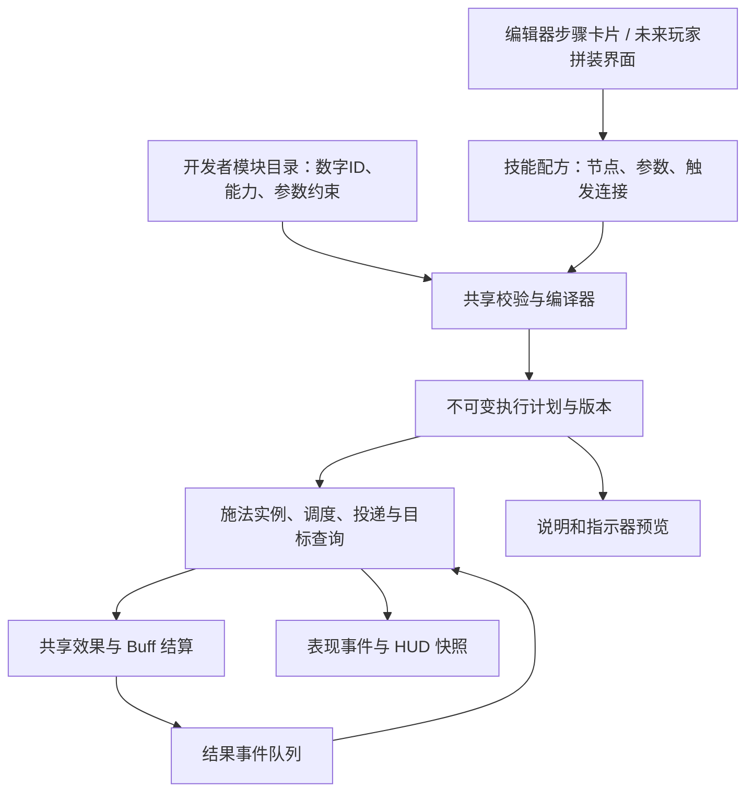

> 历史记录：当前规则请从 [开发文档总览](../README.md) 查阅。本页中的旧操作和旧验证结果不代表当前版本。

# 自由组合技能 V2：模块、配方与执行方案

日期：2026-09-28。状态：**调研和设计提案；未实现本文件中的新系统**。

本轮用户希望先讨论思路、重新设计：技能由多个选项和效果拼装，按数字 ID 引用，未来开放给玩家。本文不把建议当成用户已确认的数值，不替代现有实现说明。仅新增设计文档和入口，不修改代码、资源、场景或当前 Excel。

## 1. 设计结论

采用 **模块目录 → 技能配方 → 校验与编译 → 不可变执行计划 → 战斗实例**。

开发者先实现可复用模块，为模块声明参数、输入输出、适用条件和开销。技能配方记录用哪些模块、参数是多少、发生什么事件后接下一步。玩家以后使用同一配方结构，只开放已解锁的模块和允许修改的参数。

首版界面采用中文步骤卡片，内部采用有类型端口的有限事件流程。支持顺序、多效果、延迟和有限分支；循环由有次数上限的重复/连锁模块表达。暂不提供任意脚本、任意回连的通用编程工具。

“自由”具体指：同一个已实现模块能在兼容上下文中重用和组合；新机制仍需程序实现并明确生命周期。选项数量不是架构完整性的指标。

## 2. 调研依据与取舍

以下为实际访问的第一方资料或官方托管资料，检索日期为 2026-09-28。引用提供依据，后面的项目设计是团队结合现状作出的推导。

| 资料 | 能借鉴什么 | 本项目取舍 |
| --- | --- | --- |
| [Epic：Gameplay Ability](https://dev.epicgames.com/documentation/en-us/unreal-engine/using-gameplay-abilities-in-unreal-engine) | 激活检查、消耗提交、异步任务、事件上下文及结束清理有各自职责 | 借鉴生命周期；不移植 Unreal 类体系或联网预测系统 |
| [Epic：Gameplay Effects](https://dev.epicgames.com/documentation/en-us/unreal-engine/gameplay-effects-for-the-gameplay-ability-system-in-unreal-engine) | 效果定义与运行实例分离，持续/周期/叠层有明确语义，表现反馈独立 | 沿用现有单位权威和 Buff 贡献聚合，补充结果事件和版本 |
| [Epic：Gameplay Tags](https://dev.epicgames.com/documentation/unreal-engine/using-gameplay-tags-in-unreal-engine) | 分层标签表达能力、要求和阻止条件 | 标签用于筛选和兼容；类型化输入输出仍负责连接合法性，标签不能代替执行代码 |
| [Path of Exile：官方技能宝石说明](https://www.pathofexile.com/game) | 辅助宝石改变技能行为，例如连锁或多弹体 | 玩家用明确的模块选项；每个修饰模块声明影响对象和代价，不给所有技能展示无效选项 |
| [Noita：开发商 Steam 页面](https://store.steampowered.com/app/881100/Noita/) | 自行组合魔法是明确的产品玩法 | 借鉴创造空间；不将社区解析的法杖内部机制当作已验证源码架构 |
| [Dota 2 官方中文站：数据驱动技能](https://www.dota2.com.cn/wiki/Dota_2_Workshop_Tools/Scripting/Abilities_Data_Driven.htm) | 事件、动作、目标上下文、Modifier 分工 | 借鉴“发生什么 → 对谁做什么”；该文为历史创意工坊文档，不等于当前 Dota 商业游戏全部底层实现 |
| [Unity 6.3：ScriptableObject](https://docs.unity3d.com/6000.3/Documentation/Manual/class-ScriptableObject.html) | 编辑器定义资源、共享配置；Player 保存需要自己的存储机制 | SO 用于开发者内容，玩家配方保存为版本化纯数据文件，不依赖 AssetDatabase |
| [Entities 1.4.8：Blob assets](https://docs.unity3d.com/Packages/com.unity.entities@1.4/manual/blob-assets-concept.html) | 不可变、非托管数据可并行读取并用于 Burst | 配方在装备/修改时编译，运行期不逐目标解释 SO 或查字符串 |

补充核对了 [Noita 的 GDC 演讲简介](https://www.gdcvault.com/play/1025695/Exploring-the-Tech-and-Design)：主题主要是物理模拟与涌现玩法，没有据此声称其采用本文的技能编译器。Valve 原英文页返回 403，使用上述官方中文站承载的文档；PoE 2 官网仅返回 JavaScript 提示，因此采用可读取的 PoE 官方介绍，不混用两代具体规则。

## 3. 现有项目事实：保留什么，缺什么

当前版本 Unity 6000.3.18f1，Entities 1.4.8，URP 17.3.0。静态审查证据如下，路径相对项目根目录。

| 已检查事实 | 证据 | 设计影响 |
| --- | --- | --- |
| SkillStage 已拆分目标/形状/投递/效果；有 effects 和 impactEffects 两个列表 | Assets/Game/Abilities/Core/SkillDefinition.cs:43 | 能保留定义和行为迁移，不重新做固定英雄技能类 |
| Submit 在释放流程中预先排好各阶段；尚无通用事件连接 | Assets/Game/Abilities/Core/Execution/AbilityExecution.cs:192 | 加事件连接和上下文才能支持命中/击杀后再执行 |
| 现有直线首碰已支持首目标效果和范围效果 | 同文件:126；SkillCatalog.cs:177 | R 式首碰爆炸已能表达；缺的是通用化，不是重新发明爆炸 |
| Apply 返回 void，伤害直接修改生命；死亡末尾扫描清理 | Assets/Game/Abilities/Core/AbilityEffects.cs:9；Runtime/Combat/CombatSimulationSystem.cs:121 | 要产生可靠伤害结果和仅一次的击杀事件 |
| Buff 周期伤害使用单个标量并合算多跳，不走通用 Apply | Core/BuffDefinition.cs:22；Core/AbilityEffects.cs:91 | 改成周期效果时需明确定时顺序；有事件时不能简单乘跳数 |
| EffectDefinition 没有数字 ID；Buff 只有旧字符串 ID | Core/EffectDefinition.cs:6；Core/BuffDefinition.cs:18 | 技能/英雄已有配置编号，唯一怪物类别为3000；效果与Buff目录仍缺数字编号 |
| Buff、技能槽、弹体持有库内索引；Reset 整库重编并清会话 | Core/AbilityData.cs:57；Core/Execution/AbilityExecutionData.cs:42；Runtime/Combat/GameCombatSession.cs:31 | 不能直接在战斗中覆盖旧 Blob 或重排 Buff 表 |
| AbilityUnit 是生命与属性权威；属性由有效贡献重算 | Core/AbilityData.cs:45；Core/AbilityEffects.cs:111 | 继续共用，禁止配方层建立另一份生命系统 |
| 已有数字编号登记、运行时技能索引查找 | SkillAuthoring/Editor/NumericConfigIds.cs；Core/SkillCatalog.cs:19 | 保留既有技能 1000 起、英雄 2000 起、怪物 3000 起的编号 |

预览继续使用 SkillAimPreview 和 SkillTrajectory 的已验证几何基础。本文的编译、事件队列、空间批处理等是目标设计，不能据此宣称当前执行链已经完全 Jobs/Burst 化，或通过万敌完整战斗性能验收。

## 4. 五层职责与所有权

图中事件回到调度器不代表允许配方无限循环；后文的因果、深度、次数和生命周期规则共同限制运行。

| 层 | 保存什么 | 生命周期 |
| --- | --- | --- |
| 模块目录 ModuleCatalog | 模块 ID、版本、种类、实现映射、参数定义、能力及限制、中文说明 | 内容包加载，战斗中只读 |
| 技能配方 SkillRecipe | 元信息、局部节点、引用的模块 ID、参数覆盖、事件连接 | 编辑草稿/存档；不存实体引用或冷却 |
| 执行计划 SkillProgram | 验证后的操作、紧凑索引、参数块、事件路由、预算、调试映射 | 会话程序仓库拥有；同内容可共享 |
| 技能装配与施法实例 | 所有者、槽位、等级、冷却/充能；每次施法来源/排期/随机状态 | 所有者及单次施法；不能写回定义 |
| 表现与预览 | 图标、轨迹、范围说明、实际结果的展示事件 | UI/场景作用域，不判定命中 |

SO 编辑器、未来 Excel 导入、玩家保存数据均先转换为同一个纯数据配方，再进入编译器。编译器不得引用 UnityEditor；运行计划不得引用托管 SO。保留现有共享结算，模块执行器仅产生统一请求及结果。

## 5. 积木分类：按职责组合

| 分类 | 回答的问题 | 示例 |
| --- | --- | --- |
| 施法外壳 | 何时可施放、多久释放、付什么代价？ | 主动释放、前摇/后摇、冷却、充能、资源 |
| 瞄准输入 | 玩家给什么意图？ | 自身、点、方向、单位 |
| 投递 | 怎样到达？ | 即时、直线、目标点飞行、三维抛物线 |
| 目标查询 | 影响谁、以哪里为中心？ | 指定单位、附近敌人、全体敌人、命中位置圆形 |
| 几何 | 查询哪片空间？ | 圆/扇/矩形；未来有高度限制的柱体或球体 |
| 原子效果 | 对目标做什么？ | 伤害、治疗、施加 Buff、驱散；后续实现击退等 |
| 持续状态 | 留下什么、多久、怎样叠加？ | 减速、攻速、持续伤害、控制 |
| 流程与条件 | 何时继续、重复几次？ | 到达后、命中后、延迟、有界重复、有限连锁 |
| 修饰 | 修改哪一项行为？ | 多弹体、范围倍率、次数、伤害倍率 |
| 表现 | 如何看见和听见？ | 指示器、弹体外观、命中特效、音效 |

“范围伤害”由目标查询和伤害效果组合；“冰霜爆炸”由位置、范围、伤害、减速和表现组合。伤害属性与“是否减速”分别配置，避免冰属性被硬编码成必然减速。

枚举用于程序支持的有限语义，例如事件种类、运算方式、目标关系。次数、半径、延迟属于参数。大量内容定义用 ID 和标签组织，不为每个具体技能新增枚举。只有真正实现了执行语义的选项才能启用。

### 3D 空间合同

- 坐标默认世界空间，1 Unity 单位 = 1 世界坐标单位；速度单位/秒，角度度数。
- 区分施法距离、弹体碰撞范围、最终效果范围，不能共用一个含糊的 radius。
- 现有地面圆/扇/矩形迁移时保持原行为；新增高度限制、球形或胶囊必须同时补目标检测和预览，未实现选项禁用。
- 目标查询显式声明中心来源、朝向、水平/三维距离模式、垂直范围、阵营及存活条件；障碍/遮挡另属碰撞策略，不恢复已关闭的迷雾。
- 抛物线是投递轨迹。到达点可接圆形查询、施加状态或其他动作；飞行碰撞、落地、寿命终止是不同事件。
- 地面投影只说明平面足迹；有高度限制时额外显示线框，避免地面圆让人误以为上下所有高度都命中。

## 6. 数字 ID：定义与一次使用要分开

沿用现有技能 1000–1999、英雄 2000–2999、怪物 3000–3999。新增范围**仅为本提案预留建议，尚未登记或修改资产**：

| 内容 | 建议编号 | 说明 |
| --- | --- | --- |
| 效果定义 | 4000–4999 | 例如 4000 伤害、4002 施加 Buff，参数契约由定义指定 |
| Buff 定义 | 5000–5999 | 例如 5000 减速，生命周期策略归定义 |
| 其他可复用模块 | 10000–99999 | 投递/查询/流程/条件/修饰等通过 category 分类，无须再各占固定千号段 |

注册表验证 ID 与类型；执行语义不能通过 ID 前缀或 `if (id == 4000)` 判断。定义指向已注册的实现类型，编译成操作码；运行热路径使用索引。编号耗尽须显式扩展规则，不能撞入其他已占用范围。

一个组合需要以下不同身份：

| 身份 | 举例 | 用途 |
| --- | --- | --- |
| 官方技能定义 ID | 1002 | 预设内容、英雄默认装配 |
| 模块定义 ID | 4000 | 查“伤害”这一块积木 |
| 配方内节点编号 nodeId | 3、4 | 同一个伤害模块出现两次时，区分这两次使用；配方内唯一 |
| 玩家配方编号 recipeId | 某存档内的 1、2、3 | 玩家创建的成品；不占用官方技能千号段 |
| 单次施法编号 castId | 会话分配 | 命中归属、去重、预算和调试 |

玩家配方以“存档/作者命名空间 + 数字 recipeId”定位；导入别人配方时分配本地编号并保留来源信息。分享文件携带配方内容与依赖版本，不能只发送一个本地 ID。程序可用内部内容哈希校验/缓存，用户界面依然显示数字。

## 7. 配方结构与一个具体例子

建议字段：

- `schemaVersion`：配方文件格式版本。
- `catalogVersion`：模块目录版本；模块还可有自身修订号。
- 官方 `skillId` 或玩家 `recipeId` 与命名空间；两者不能混用。
- 施法外壳：名字、输入类型、距离、前后摇、冷却、消耗等。
- `nodes[]`：局部 nodeId、moduleId、模块版本、类型化参数。
- `bindings[]`：来源节点、事件端口、目标节点、输入绑定、顺序和次数策略。

连接既要说明“何时执行”，也要说明“使用哪个点/哪个单位/哪组结果”。只保存 `[4000,5000]` 无法描述技能。

示例：抛物线落点伤害并减速。以下 ID 和数值仅作讲解，不写入当前技能：

| 节点 | 模块 | 配置/来源 |
| --- | --- | --- |
| 1 | 10000 抛物线投递 | 目标来自施法目标点；飞行0.8秒，弧高4单位 |
| 2 | 10001 圆形敌方查询 | 节点1“到达”事件的位置；半径5单位，几何使用明确的地面模式 |
| 3 | 4000 伤害 | 节点2的目标集合，伤害30 |
| 4 | 4002 施加 Buff | 同一目标集合中仍存活的单位；buffId=5000，持续2秒，速度乘数0.7 |

执行：释放 → 节点1；到达 → 节点2；查询完成 → 节点3 → 节点4。空地允许释放，到达事件仍发生，空目标集合自然结束。修改此配方的伤害只覆盖该节点参数，不修改共享4000定义。

本例要求5000定义显式开放“持续时间”和“减速倍率”两项类型化覆盖；覆盖写入本次不可变 Buff 规格和实例，不修改共享 BuffDefinition。不同规格的合并必须遵守下方 Buff 合同。

同一 4000 模块也能用于“直线首碰伤害”“自身周围伤害”“Buff 每次周期伤害”。同一 5000 减速可被不同技能引用。两次调用同一效果的顺序明确；先伤害致死后不会再给尸体加普通减速。

### 另外两个需要证明的组合

**有限连锁**：首碰 → 伤害 → 从上一目标位置找最近未访问敌人 → 次级投递。最多额外3个，距离6单位，每次伤害乘0.8。访问集合、剩余次数与根施法共享；次级伤害不重新启动整条根连锁。无目标立即结束，目标死亡后使用事件位置快照。

**全体敌方时停**：释放 → 全体存活敌人查询 → 时停模块。没有伤害节点，输出伤害自然为0。完整时停未实现前，该配方不可装备；不能用现有禁止移动/攻击/施法标志宣称冻结了阶段、弹体和计时。

## 8. 模块必须先写清的合同

每个可拼装模块至少声明：

1. ID、版本、中文名称、分类、描述和是否向玩家开放。
2. 实现类型与编译处理器；对应运行操作确实存在。
3. 输入类型、必需上下文、输出数据和事件端口。
4. 参数类型、默认值、单位、上下限、玩家可改档位。
5. 必需能力/标签、禁止组合和去重规则。
6. 作用对象和状态所有者、开始/结束/中断/失败行为。
7. 触发次数、派生数量、寿命及负载估算方式。
8. 指示器/自然语言说明/调试信息的生成规则。

连接检查例子：没有弹体的查询节点不能加“穿透”；只给位置的到达事件不能直接当成“命中单位”；“命中点爆炸”必须绑定命中位置；修改重复次数必须作用于一个明确节点或子流程，不能隐式影响整份配方。

同一父类适合共享模块元数据和校验/编译入口；伤害、投递、目标查询仍使用各自类型化参数。不要做一个含几十个无关字段的万能效果类，也不要让每个效果直接操作 UI、实体管理器和所有战斗状态。

## 9. 事件、Buff 和时钟合同

### 9.1 不能混为一个 OnHit

| 事件 | 明确语义 |
| --- | --- |
| CastReleased | 前摇结束且本次释放有效 |
| ProjectileArrived | 到达目标位置，不保证有目标 |
| ProjectileHit | 弹体通过碰撞、阵营、去重等检查得到目标 |
| TargetsResolved | 一次目标查询完成；可为空，作为整组事件 |
| DamageResolved | 权威结算完成，包含请求值/实际生命损失，损失可为0 |
| Killed | 权威生命从存活变为死亡，只产生一次 |
| BuffApplied / BuffTick / BuffEnded | 状态生命周期；结束含到期/驱散/死亡/卸下原因 |

吸血需绑定实际伤害结果；弹体命中即使没有伤害也可施控制。周期伤害不能自动算一次普攻或弹体命中。查询结果事件是一组结果，不能默认展开成每个目标各释放一整条技能。

事件携带 `castId / parentEventId / programVersion / nodeId / source / attribution / target / position / direction / result / depth`，并继承同一根触发预算。归属快照与实体引用分开，实体使用前检查版本和存活。击杀位置提前快照，不能销毁后再查 Transform。

处理顺序必须稳定：提交请求 → 结算属性和生命 → 记录结果事件 → 派生动作入队 → 到安全边界清理实体。拒绝同步递归调用伤害。相同模拟步按根施法序号、节点顺序、稳定单位编号处理；并行采集后稳定合并，不承诺未经验证的跨平台确定性。

### 9.2 Buff 扩展

保留定义/实例分离、来源合并、贡献聚合、层数和刷新规则。逐步把固定 periodicDamage 迁移为“周期触发的效果计划”，使用共享伤害请求。普通玩家不能任意改变 Buff 的来源合并、时钟或结束语义。

参数覆盖后生成规格身份 specKey。新配方的默认合并键在定义及来源策略之外包含 specKey，避免同定义的不同强度互相覆盖；同一逻辑 Buff 家族仍共享总层数/活动规格上限，不能靠微调参数绕过限制。哪些贡献可同时生效、是否择强由 Buff 定义固定。旧技能迁移先保持旧合并规则，只有启用规格覆盖的新配方采用这项新增合同。

默认刷新不推迟下一跳；明确到期边界是否包含最后一跳。有结果事件、吸血或击杀回调的周期必须按语义逐跳处理，不能以总伤害乘跳数替代。独立层到期或新叠加政策未实现前不提供有效选项。

### 9.3 完整时停是后续专门模块

提案语义：施放时选中存活敌人；暂停其移动、攻击、施法进度、排期、归属弹体及普通 Buff 的局部战斗时钟。外部伤害仍可杀死冻结单位。时停解除使用独立继续前进的会话时钟；施法者和 UI 不停，新生成敌人不自动加入本次快照。多个时停贡献独立解除。

涉及世界暂停、时停中生成弹体、永久领域持续覆盖等是不同规则，不隐式继承。不能调用 Time.timeScale=0 代替。先定义合同，待该专门模块和相关时钟消费者实现后再开放。

## 10. 玩家开放与平衡

开发者可以定义模块；玩家选择模块。玩家配方只引用安装内容中已实现、已解锁且允许组合的条目，参数按授权范围校验。不接受任意 C#、反射类型名、执行器路径或 Unity 资源路径。

建议保留英雄差异：英雄提供基础属性、模块解锁倾向或装配容量；QWER仍仅为槽位。解锁玩法和具体容量尚未实现，不在此轮添加被动或改变已确认的寒冰技能。

平衡分为三项，不能只用一个总分：

- **合法性**：端口兼容、参数范围、模块权限和生命周期满足。
- **玩法代价**：冷却、资源、伤害倍率、数量、范围、控制覆盖率之间的取舍；强组合由人工规则约束。
- **计算开销**：弹体、查询、目标访问、派生和 Buff 数量。高开销组合即使伤害为0也不能无限生成。

首版玩家参数优先预设档位，例如“小范围/中范围/大范围”，同步展示代价；开发者可编辑精确数值。先用定制规则和测量平衡连锁/控制/持续触发，再评估统一估价公式，不能声称任意组合自动平衡。

## 11. 万级战斗与组合爆炸

### 11.1 编译期检查

- 数字 ID 存在且类别正确；格式/目录/模块版本受支持。
- 参数类型、有限数值、上下限、必需字段检查。
- 局部 nodeId 唯一；连接、输入上下文与事件端口有明确类型。
- 展开可复用子流程时检查跨配方引用；无任意环或无限递归。
- 有界重复/连锁可估算最坏调用次数；统计投递、查询、目标访问及结果事件量。
- 玩家权限、互斥修饰、成本和资源预算全部通过才生成计划。
- 编译失败保留上一个可用配方；报错定位配方/节点/参数，避免保存半成品覆盖当前技能。

### 11.2 首轮预算建议（AI 提案，未测量）

| 项目 | 建议起点 |
| --- | ---: |
| 玩家配方根触发 | 1个主动施放 |
| 配方节点 | 16个 |
| 派生分支深度 | 4层 |
| 单节点重复 | 8次 |
| 有限连锁命中 | 共4个不同目标 |
| 单根施法额外投递 | 最多32个 |
| 延迟/派生流程寿命 | 10秒；独立 Buff 用自己的有界生命周期 |

这些不是性能结论，也不是缩小现有官方技能范围的迁移要求。开发者内容同样需要合法性检查；有经过测量的单独预算档，不允许关闭安全上限。

**全体目标数与派生分支数分开。** 对一万敌人批量施加一个控制效果可以是一条计划；让每个敌人各生32个弹体是32万次派生。不能把“最多32个子投递”误写成“全体技能只影响32个怪”。

即使配方图无环，Buff、反伤、跨技能监听仍可能组成运行循环。因此所有派生继承根归属和共享预算；连接默认有限触发次数；周期计划有独立计时窗口配额和总生命周期。之后开放被动监听时按拥有者/来源/事件种类索引订阅，不能广播到每个单位的每个效果。

寿命边界：10秒限制只属于本次短期投递/派生链。持续 Buff 保存原程序版本、来源快照和受限周期上下文，不继承已结束投递链的截止时间。每一跳拥有本跳的有限派生额度，并共同消耗 Buff 生命周期累计额度及拥有者/会话配额；来源因果链和再触发限制不能因新一跳而清零。Buff结束后停止新周期，既有派生按明确的结束策略收尾；待 Buff、队列、弹体与 Job 的所有引用归零才释放旧程序版本。

### 11.3 运行措施

- 装备或修改时编译并缓存，不逐帧解析配方；按模块目录版本、配方参数和授权策略确定缓存键。
- 热路径用紧凑结构、批量请求、显式 ECS 作业依赖；不为每次命中创建 SO/托管效果对象。
- 局部查询使用共享空间索引；相同查询结果可在明确一致的结算边界共享。全体查询批处理。不能在效果节点内对每个受击目标再次扫描全场。
- 语义事件与表现事件分离；特效可以合并、限频、减少粒子，命中和必需伤害不可静默丢失。
- 容量不足时：对必须完整执行的配方在接受施法前检查/预留关键资源；超过支持负载则拒绝并说明。可裁剪的次级派生必须在模块合同和玩家说明中写清触发上限及停止规则。
- 运行期记录哪个 castId/nodeId 达到上限；溢出不得伪装成“正常全部结算”。测量查询、结算、队列、弹体、Buff 和 GC 的分项开销。

## 12. 玩家改配方时，旧技能怎么办

采用不可变程序版本，模块/Buff目录在一局中固定，或同样受目录版本句柄管理。

1. 在编辑草稿上修改，编译出新 ProgramVersion；失败不换装。
2. 首版建议只在非施法动作期间的装配边界切换；不清空敌人/旧弹体。
3. 切换后新施法使用新计划，旧施法/弹体/延迟阶段/关联 Buff 保留原计划和参数。
4. 槽位运行状态不因编辑重置；冷却/充能恢复保留已产生的到期时间，不通过换配方刷新。若新容量更小，现有充能取较小值；特殊命中蓄层条件变化时清该条件进度并明确显示。
5. 会话程序仓库持有计划和引用，所有使用者结束、相关 Job 完成后释放旧 Blob；关闭会话统一清理。
6. 临时强度来自施法快照或显式实时属性绑定，不能在不同模块随意选择。首版默认来源强度在释放时快照，目标状态在效果执行时检查；迁移旧技能逐项保持原合同，有差异先记录。

存档保存配方、数值版本及依赖 ID，不保存内存索引或 Entity。普通配方存档不等于战斗中途完整存档。失效模块不能静默变成别的技能；能迁移则明确迁移，不能迁移则显示缺失并禁止装备。目录补丁是否改变旧配方数值需显式版本政策，不能只更改旧ID对应行为后当作完全兼容。

## 13. 编辑器、Excel 与实施顺序

### 中文步骤编辑器

沿用一个技能设计器入口，不新增一堆工具菜单：

- 左侧模块库按“投递、目标、效果、状态、流程、修饰”分类，显示中文名+数字 ID。
- 中间按“施放 → 命中/到达后 → 效果 → 后续动作”的卡片顺序编辑；添加菜单只提供合法选项，灰色项说明缺少什么。
- 右侧实时显示中文说明、最终参数、消耗/预算及错误定位。
- 预览显示路径与作用范围，多个分支可切换查看；高级只读流程图帮助定位来源，后续再评估自由连线编辑。
- 每节点显示“使用默认参数/本配方覆盖”，共享模块修改会提示影响哪些配方。保存时生成新版本。

未来玩家界面使用同一逻辑，只提供已解锁模块、授权档位与有效连接。先给玩家可理解的动作词，不把操作码、Blob或内存预算细节暴露成游戏操作。

### Excel 后续结构

保留英雄、技能、怪物及装配表；新增模块定义、Buff、配方节点、节点参数、事件连接表。主外键都是数字，节点关联键为配方身份+nodeId。参数以模块声明的类型化列或参数定义+类型化值行表达，避免把整套流程塞在单个字符串单元格。

权威建议：开发阶段 SO/技能设计器为内容权威；Excel先导出审阅。正式做导入时采用“校验 → 差异预览 → 完整提交”，不建立双向自动覆盖。玩家保存独立配方。**本轮不新增这些表、不声称已实现导入。**

### 分阶段交付

| 阶段 | 交付边界 | 必须证明 |
| --- | --- | --- |
| A：模块与配方合同 | 效果/Buff数字目录、类型化参数、纯数据配方、校验与编译适配 | 同效果被两配方引用互不污染；重复/缺失ID、非法参数拒绝 |
| B：一条完整执行链 | 释放、到达/命中、目标查询、共享伤害/Buff、结果事件、版本化计划 | 直线首碰和抛物线到达复用同一个伤害+减速组合；前后摇等不变 |
| C：受控扩展 | 周期共享效果、一次击杀分裂、有限重复/连锁、预算 | 无回跳/无递归，零伤害仍可控制，击杀归属只结算一次 |
| D：易用编辑与持久化 | 中文步骤、兼容提示、ID查询、版本保存及玩家入口适配 | 开发者和玩家入口同一配方产生同语义；存档重载及缺失版本报错 |
| E：开放与测量 | 解锁/代价/参数档位、完整战斗负载与调试 | 玩家组合预算有效；万敌性能用对应 Player 实测证明 |

迁移方式：先用适配器把现有 SkillStage 转为新计划，保持技能 ID、GUID、数值、命中与前后摇合同；新旧输入最终进入同一个执行层。差异清单和恢复副本先落地，逐步停止旧执行分支。不能仅新增另一套演示再让 Game 留在旧逻辑。

## 14. 本轮结论与验证状态

- 用户方向：自由拼装、数字ID、先做好模块功能、未来玩家可用。
- 技术与策划一致建议：纯数据配方、类型化连接、共享编译器、定义与状态分开。
- 主 AI 取舍：首版采用步骤卡片与有限事件流程；先贯通模块/事件/版本，有限连锁随后；完整时停暂作专门模块合同。编号扩展与预算均为提案，未修改现有注册表。
- 已完成：外部资料查阅、源码与文档静态审查、职责/身份/事件/时钟/版本/预算/迁移设计。
- 未完成：新配方编译器、事件调度、模块数字目录、玩家编辑、Excel导入，以及所有新规则的运行与性能验证。
- 本轮未启动 Unity、未编译、未游戏测试；没有据此声明实现或性能通过。

## 2026-09-28 批准后的实施索引

用户已授权按本方案实施。模块/配方/执行版本/中文步骤与 JSON 的首轮代码及迁移已经落地；上文“本轮未实现”描述的是设计调研阶段。实际完成边界、AI 取舍和验证证据以 [V2 实施记录](skill-composition-v2-implementation.md)为准。完整时停、有限连锁、Buff 周期配方、玩家 UI 与 Excel 导入仍为后续内容。