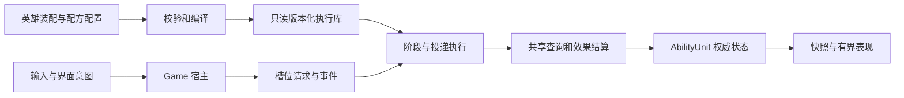

# 组合技能与 Buff 基础架构

2026-10-24 现行契约。游戏采用三关远征、十五级成长、Q/E/R/F 快速施法与满级形态；数值见 [英雄与技能](heroes-and-skills.md)，扩展、迁移和执行职责见 [工程与工具](engineering-and-tools.md)，实际结果见 [验证记录](validation.md)。此前架构过程和旧验证保存在 [历史记录](History/ability-foundation-history.md)，不能将其中的旧操作、数值或隔离工作区要求恢复到当前项目。

## 架构底线

技能地基优先于具体技能数量。英雄装配技能；技能组合目标、形状、投递、时序、次数和效果；效果组合伤害、治疗、状态、驱散及明确支持的位移。输入槽、技能 ID、英雄名只用于身份与装配，不作为结算分支。

新增机制先检查现有模块是否能表达。确需扩展时，增加独立配置、编译字段与执行语义，记录既有积木不能表达的原因。不能用每个技能一份完整配置类、空接口、占位枚举、改名或 SO 包装固定逻辑代替模块架构。

## 职责、数据和生命周期

- `Roguelike.Abilities.Core` 不依赖输入、相机或 HUD。定义资源及编译后的 Blob 只读，不保存冷却、血量、层数、已选形态等运行状态。
- `AbilityUnit` 是 Game 的生命、法力、属性与控制权威。普攻、英雄技能、怪物技能、装备和 Buff 都通过共享效果结算。`CombatPlayer` 等镜像只服务显示与统计，不反向覆盖权威。
- 每个拥有者持有独立技能槽、等级、冷却、充能、计数、Buff 和时序。`GameCombatSession` 拥有编译库、原型和运行容器；重开、换图、返回选择都会结束作业并释放旧运行态。
- `RecipeProgramStore` 管理不可变版本。热换形态时，新请求使用新版本，在途阶段仍可引用旧版本；引用释放后才回收。`ReleaseOwner` 清理拥有者的在途状态和穿透命中集。
- `RunState` 只保存跨关快照；营地、换图和结算有明确捕获/恢复边界，返回选择清空。当前不提供磁盘存档。
- 表现消费阶段几何和反馈快照。预警、数字、死亡碎片、闪电均有数量预算，不参与命中裁决。

## 配方合同

| 维度 | 当前语义 |
| --- | --- |
| 输入 | 自身、单位、目标点、方向；Game 快速提交，槽位可以配置键位 |
| 查询 | 单体、区域、全体，阵营与存活过滤；全体不等于无限半径圆 |
| 几何 | 圆、扇、线、环；半径、范围、角度、内径由共享几何计算 |
| 投递 | 即时、落点、直线首碰/穿透、三维抛物线；穿透同条弹体跨帧去重 |
| 阶段 | 有限延迟、次数、间隔；可跟随拥有者、寻找密集点、重复推进和起始偏移 |
| 成长 | 等级对应伤害、消耗、半径、数量、散射、附加目标等编译参数；形态替换配方 |
| 效果 | 固定/攻击倍率/目标最大生命倍率伤害与治疗、Buff、驱散、拉拽和击退 |
| Buff | 期限、周期、来源、叠层、修饰和控制；周期伤害保存来源快照 |
| 触发 | 主普攻计数、主普攻命中、主动施法；派生伤害不递归触发同一装备事件 |

单体阶段必须具有有效单位或碰撞来源。非法枚举、悬空引用、不能表达的组合须在编译时给出中文错误；不能静默退化成另一个效果。新 opcode 必须同时具有编译和运行语义。

施法接受时检查生命、控制、距离、冷却、充能和资源，只支付一次。前摇到期调度阶段，后摇独立于弹体寿命；动作锁由 `AbilityCastTiming` 共享查询。控制打断未释放阶段不退款，死亡清理拥有者状态。延迟执行重新检查目标有效性，不读取已销毁实体。

阶段中心与方向默认在提交时快照；显式跟随模块才更新中心。查询读取当前存活目标；同次查询去重，不同阶段可重复命中。直线弹使用扫掠最早接触点，360° 散射不重复首尾方向。Game 模拟每帧 dt 上限 0.1 秒，严重卡顿时模拟变慢，不宣称墙钟追赶。

拉拽 `StopDistance` 保留与来源的最小距离，不穿过来源；位移免疫在共享入口处理。冷却缩减默认上限 50%，遗物可提高至 60%；总减伤上限 70%。这些数值是当前规则，不应复制到 UI 再计算伤害。

## 扩展与编辑边界

新增模块采用类型化配置和明确校验，在编译边界转换为只读数据；运行层通过通用查询、属性和效果接口执行。不能在每个敌人的热路径创建独立托管效果对象、反射查找或按显示名分支。

技能工作台保留编辑、复制、JSON 配方事务及预览。机器 ID、序列化字段和 GUID 稳定；中文 Inspector 通过有效 CustomEditor / PropertyDrawer 绘制，枚举显示名使用 `InspectorName`。资源改名同步生成器与编号登记，保留 `.meta`。

11 项现行属性沿用稳定枚举值，删除的经验加成、攻击距离、暴击率与暴击伤害编号不复用，装配旧项明确拒绝。旧天赋字段只用于检测迁移错误，不再建立运行态。旧独立演示、Dota 操作、目标面板、固定商店和地面装备已删除。

完整时停、玩家自由装配界面、Excel 写回与存档不是本轮远征交付范围。不能因为存在控制标记或 JSON API 就声称这些功能已经完成。

## 验证约束

新增机制检查编译拒绝、效果语义、生命周期及共享执行回归；多关状态需要 Player 流程检查。编辑器注册测试不替代实际 Inspector 查看，自动发出操作不替代键鼠手感。未经完整 Player 实测不能宣称万级战斗性能通过。

本轮通过项、压力测试条件、平衡观测和用户暂缓的界面检查统一记在 [验证记录](validation.md)。后续开发沿用主目录 `D:/UnityProject/myGame` 的 `main`，不恢复历史工作树流程。
